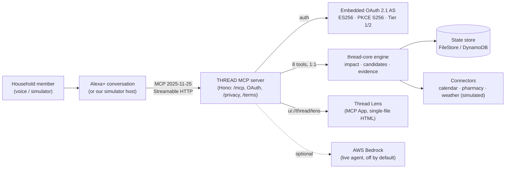

# THREAD for Alexa+ — *Don't lose the thread.*

[](https://github.com/learnermaker/thread-alexa/actions)


THREAD keeps real-world commitments alive across people, events and apps. When
something changes, it finds what is affected, determines who needs to act, shares
only the necessary context, and stays with the commitment until it's actually
resolved.

**Signature question: _What does this change affect?_**
Alexa+ is the conversation. THREAD is the coordination.

Built as an **Alexa+ MCP server · MCP App · Agent Skill**, on top of the
open-source [thread-core](https://github.com/learnermaker/thread-core) engine.

---

## Try it in 60 seconds

**Live link:** _(deployed Function URL — added at submission)_ · open it and press
**Play the story**.

**Or locally, zero credentials:**

```bash
npm install
npm run demo
```

Open <http://localhost:8787> and press **Play the story**. The seeded demo
household, the embedded OAuth server, the scripted agent and the simulated
connectors all run offline — no AWS account, no API keys.

Watch the ripple: at Saturday 8:21 AM, "I can't drive" fans out to every
affected commitment, THREAD proposes who takes over, shares only what the new
owner needs, and resolves each thread only when evidence says so.

---

## What's real vs simulated

| Area | Real | Simulated (for the demo) |
|---|---|---|
| MCP server | ✅ Real: Streamable HTTP, protocol `2025-11-25`, 8 tools, MCP App resource | — |
| OAuth 2.1 | ✅ Real: embedded authorization server, ES256 JWTs, PKCE S256, Tier 1/2 | `DEMO_MODE` auto-consents the sign-in step (disclosed) |
| Coordination engine | ✅ Real: `thread-core` derives impact, candidates, resolution deterministically | — |
| Identity | ✅ Real: principal comes from the token; you can only act as yourself | Household is seeded composite personas, not real people |
| Agent | Scripted agent is the default (deterministic). Live agent is real **AWS Bedrock**, toggled on | Live agent off by default |
| Voice | Pre-rendered **Amazon Polly** MP3s | — |
| Connectors (calendar, pharmacy, weather) | The engine path is real | The connectors themselves are simulated; **nothing is ordered or written** |
| Hosting | Real **AWS Lambda + DynamoDB + CDK** (synths offline) | Local run uses FileStore |
| Alexa+ device | — | No Alexa hardware; verified via MCP Inspector + our simulator |

Being upfront here is deliberate: the coordination, the auth and the engine are
real; the outside world is simulated so the demo is safe and reproducible.

---

## Architecture



- **thread-core** does the coordination: the Impact Graph, deterministic
  candidate selection, evidence and resolution, the event log.
- **This repo** is the Alexa+ surface: 8 MCP tools as thin adapters, OAuth, the
  MCP App (Thread Lens), the simulator host, the Bedrock agent and the AWS
  deployment.

See `docs/adr/` for the architecture decisions and `docs/alexa-plus-readiness.md`
for each Alexa+ requirement mapped to its implementation and test.

---

## Built on thread-core

THREAD's intelligence lives in [thread-core](https://github.com/learnermaker/thread-core),
a standalone, deterministic coordination engine (its own tests, event log and
schemas). This repository is the **Alexa+ surface** over it: transport, auth,
the tool adapters, the UI and the cloud. Core does the coordination; this repo
makes it speak Alexa+.

---

## The 8 MCP tools

`create_thread`, `list_threads`, `get_thread`, `report_change`,
`request_handoff`, `respond_to_handoff`, `record_evidence`, `confirm_action` —
each a 1:1 adapter over a `thread-core` operation. Validation, authorization,
idempotency and derivation happen in core; the MCP layer adds transport,
auth-to-principal mapping, annotations, the Lens `_meta.ui` and a voice-friendly
summary. The Agent Skill in `skills/thread/SKILL.md` teaches any agent when and
how to call them.

## Connect with MCP Inspector

1. `npm run demo`
2. In another terminal: `npx @modelcontextprotocol/inspector`
3. Transport **Streamable HTTP**, URL `http://localhost:8787/mcp`, header
   `Authorization: Bearer dev-maya`, then **Connect** — 8 tools and the Thread
   Lens resource appear.

Exported Inspector transcripts (proof it's a real MCP server) are committed under
`docs/evidence/inspector/`.

## Sign-in (OAuth)

The server embeds an OAuth 2.1 authorization server (ES256 JWTs, no cloud
account). Discovery:

- AS metadata: `/.well-known/oauth-authorization-server`
- Protected-resource metadata: `/.well-known/oauth-protected-resource`
- JWKS: `/oauth/jwks`

**Tier 1** (`client_credentials`, scope `mcp:service`) may only `initialize` and
`tools/list`. **Tier 2** (`authorization_code` + PKCE S256, scopes `mcp:tools` /
`mcp:resources`) acts as a signed-in household member.

> `DEMO_MODE=true` (default locally) auto-consents the sign-in step. Dev tokens
> (`Bearer dev-<person>`, enabled by `AUTH_DEV_TOKENS=true`) exist only for the
> Inspector and tests and are **disabled on AWS**.

---

## Deploy (AWS, synth-only by default)

```bash
npm run synth      # CDK synth; passes offline with zero AWS credentials
npm run deploy     # needs AWS credentials; creates Lambda + DynamoDB + SSM + a $5 budget
```

Hosting isn't required for judging (the repo runs locally with one command). We
also provide a live link as our own choice. Infra is in `infra/stack.ts`
(Lambda Function URL, provisioned DynamoDB, SSM-injected OAuth key, CloudWatch,
a $5/month budget alert).

Legal pages required by the Alexa+ add-on manifest are served at `/privacy` and
`/terms`; `addon-manifest.example.json` documents the manifest shape within the
documented limits (we cannot deploy an add-on for the hackathon).

## Environment variables

`npm run demo` needs **none**. All variables are documented in `.env.example`:

| Variable | Default | Purpose |
|---|---|---|
| `PORT` | `8787` | Local server port |
| `DATA_DIR` | `.data` | FileStore directory (local) |
| `DEMO_START` | `2026-10-08T19:30:00-07:00` | Fixed demo clock start |
| `DEMO_MODE` | `true` | Auto-consent the OAuth sign-in step |
| `AUTH_DEV_TOKENS` | `true` local / off on AWS | Accept `Bearer dev-<person>` |
| `PUBLIC_BASE_URL` | `http://localhost:PORT` | Issuer / resource base URL |
| `TABLE_NAME` | _(unset)_ | Set to switch FileStore → DynamoDB |
| `AWS_REGION` | — | AWS region for the deployed store |
| `OAUTH_JWK_JSON` | — | ES256 private JWK (injected from SSM on Lambda) |
| `OAUTH_CLIENT_SECRET` | — | `alexa-sim` client secret (from SSM on Lambda) |
| `LIVE_AGENT` | _(empty)_ | Non-empty enables the Bedrock live agent |
| `LIVE_AGENT_DAILY_CAP` | `50` | Per-day cap on live agent calls |

## Tests

```bash
npm run verify     # the single "is it green?" command: contract, deps, secrets, wording, legal, typecheck, tests
npm test           # vitest only
npm run e2e         # builds the Lens + simulator, then Playwright
```

**66 tests across 8 files** pass, including the Alexa+ auth checklist (A1–A21),
MCP conformance, idempotency, the golden story and the deterministic engine path.

## Latency

Local p95 is well under the Alexa+ 500 ms round-trip budget (see
`docs/latency.md`, regenerate with `npm run latency`):

| tool | p50 | p95 |
|---|---|---|
| `list_threads` | 6 ms | 10 ms |
| `get_thread` | 4 ms | 7 ms |
| `report_change` | 16 ms | 23 ms |

## Auth transcripts & evidence

- Exported MCP Inspector transcripts: `docs/evidence/inspector/`
- Alexa+ readiness matrix (requirement → implementation → test):
  `docs/alexa-plus-readiness.md`

## Architecture decisions (ADRs)

- [0001 — MCP SDK version](docs/adr/0001-mcp-sdk-version.md)
- [0002 — Stateless Streamable HTTP](docs/adr/0002-stateless-streamable-http.md)
- [0003 — Hono web-standard transport](docs/adr/0003-hono-web-standard-transport.md)
- [0004 — Schemas from core errors without structured](docs/adr/0004-schemas-from-core-errors-without-structured.md)
- [0005 — Embedded authorization server](docs/adr/0005-embedded-authorization-server.md)

## Spec-driven development

Built spec-first with Kiro and the Kiro Crew task runner. The `.kiro/` folder
(specs, steering, hooks) is committed as evidence; `docs/friction-log.md` and
`docs/product-feedback.md` record the build honestly.

## Legal

- [Privacy Policy](PRIVACY.md) (served at `/privacy`)
- [Terms of Service](TERMS.md) (served at `/terms`)

License: **Apache-2.0** (see `LICENSE` and `NOTICE`).
